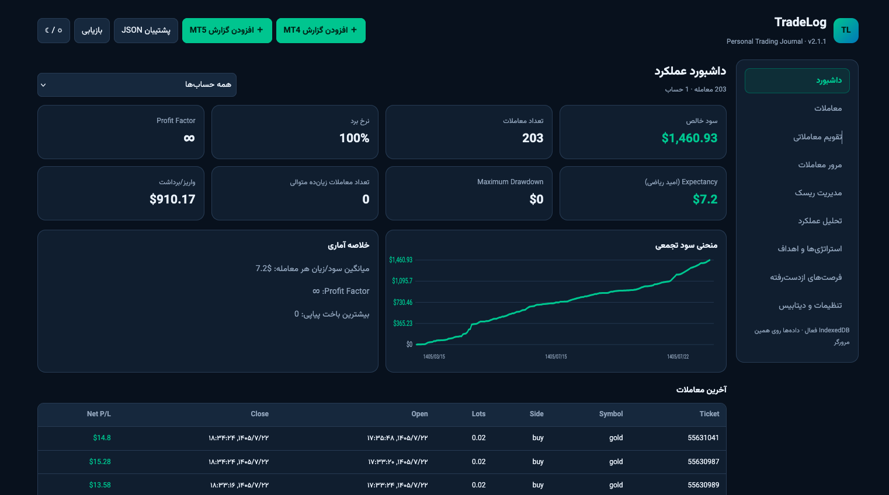
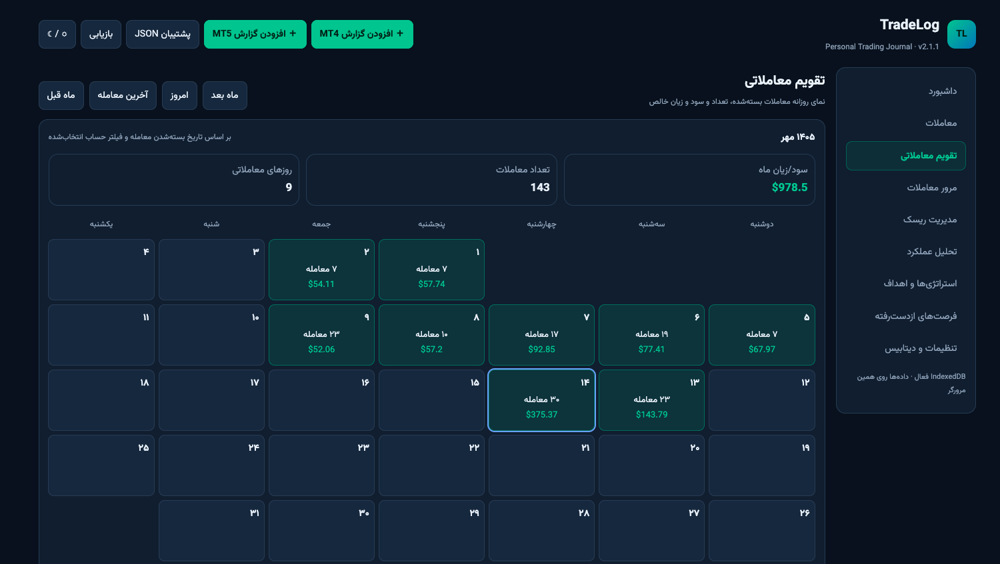

<h1 dir="rtl" align="right">TradeLog | ژورنال هوشمند معاملات</h1>

<strong>ثبت، مدیریت و تحلیل عملکرد معاملاتی</strong>

TradeLog یک نرم‌افزار ژورنال معاملاتی فارسی است که با هدف ثبت، مدیریت و تحلیل معاملات بازارهای مالی توسعه داده شده است.

این برنامه با دریافت گزارش معاملات از <bdi dir="ltr">MetaTrader 4</bdi>، اطلاعات معاملاتی را پردازش کرده و در قالب داشبوردهای تحلیلی، نمودارها، گزارش‌های آماری و شاخص‌های تخصصی در اختیار معامله‌گر قرار می‌دهد.

هدف TradeLog کمک به معامله‌گران برای ارزیابی عملکرد، شناسایی نقاط ضعف، بررسی اثربخشی استراتژی‌ها و اتخاذ تصمیمات معاملاتی آگاهانه‌تر است.

  
  

<h2 dir="rtl" align="right">✨ قابلیت‌های اصلی (Key Features)</h2>

<ul dir="rtl" align="right">
<li> <strong>اتصال به <bdi dir="ltr">MetaTrader 4/5</bdi>:</strong> دریافت و وارد کردن گزارش معاملات از تاریخچه حساب معاملاتی.</li>
<li> <strong>داشبورد تحلیلی (<bdi dir="ltr">Dashboard</bdi>):</strong> نمایش نمودار سود و زیان، شاخص‌های عملکرد و تحلیل معاملات خرید و فروش.</li>
<li> <strong>تقویم معاملاتی (<bdi dir="ltr">Trading Calendar</bdi>):</strong> بررسی تعداد معاملات و سود و زیان در بازه‌های روزانه و ماهانه.</li>
<li> <strong>مدیریت استراتژی‌ها (<bdi dir="ltr">Strategy Management</bdi>):</strong> تعریف استراتژی‌های معاملاتی و اختصاص آن‌ها به معاملات.</li>
<li> <strong>رتبه‌بندی استراتژی‌ها (<bdi dir="ltr">Strategy Ranking</bdi>):</strong> مقایسه عملکرد، سودآوری و نرخ برد استراتژی‌های معاملاتی.</li>
<li> <strong>شاخص‌های کلیدی عملکرد (<bdi dir="ltr">KPIs</bdi>):</strong> ارائه معیارهای آماری برای ارزیابی کیفیت و عملکرد معاملات.</li>
<li> <strong>مدیریت واریز و برداشت (<bdi dir="ltr">Deposits &amp; Withdrawals</bdi>):</strong> مشاهده و تحلیل گردش مالی حساب معاملاتی.</li>
<li> <strong>تشخیص معاملات تکراری (<bdi dir="ltr">Duplicate Detection</bdi>):</strong> شناسایی هوشمند اطلاعات تکراری و جلوگیری از ثبت مجدد آن‌ها.</li>
<li> <strong>نمایش ساعت سیستم و بروکر:</strong> نمایش زمان محلی کاربر، زمان سرور بروکر و اختلاف زمانی آن‌ها.</li>
</ul>

<h2 dir="rtl" align="right">🚀 ویژگی‌های اجرایی (Lightweight &amp; Portable)</h2>

یکی از ویژگی‌های مهم TradeLog، سادگی اجرا و عدم وابستگی به زیرساخت‌های پیچیده است.

<ul dir="rtl" align="right">
<li>توسعه‌یافته در قالب یک فایل مستقل <bdi dir="ltr">HTML</bdi></li>
<li>بدون نیاز به نصب نرم‌افزار یا وابستگی‌های جانبی برای اجرا</li>
<li>قابل اجرا مستقیماً در مرورگرهای وب</li>
<li>بدون نیاز به راه‌اندازی <bdi dir="ltr">Web Server</bdi> یا <bdi dir="ltr">Backend</bdi></li>
<li>قابل استفاده به‌صورت محلی روی سیستم کاربر</li>
</ul>

<h2 dir="rtl" align="right">🖥️ پیش‌نیازها (Requirements)</h2>

<ul dir="rtl" align="right">
<li>مرورگر وب مدرن مانند <bdi dir="ltr">Google Chrome</bdi>، <bdi dir="ltr">Mozilla Firefox</bdi> یا <bdi dir="ltr">Microsoft Edge</bdi></li>
<li>نرم‌افزار <bdi dir="ltr">MetaTrader 4</bdi> برای تهیه گزارش معاملات</li>
<li>فایل گزارش خروجی حساب معاملاتی از <bdi dir="ltr">MetaTrader 4</bdi></li>
</ul>

<h2 dir="rtl" align="right">📥 نصب و راه‌اندازی (Installation)</h2>

TradeLog نیازی به نصب ندارد.

<ol dir="rtl" align="right">
<li>آخرین نسخه برنامه را از بخش <a href="../../releases">Releases</a> دریافت کنید.</li>
<li>فایل HTML برنامه را از حالت فشرده خارج کنید (در صورت نیاز).</li>
<li>فایل TradeLog را مستقیماً با مرورگر وب باز کنید.</li>
<li>برنامه آماده استفاده است.</li>
</ol>

<h2 dir="rtl" align="right">📊 آموزش استفاده (User Guide)</h2>

<h3 dir="rtl" align="right">مرحله اول: دریافت گزارش معاملات از MetaTrader 4</h3>

ابتدا نرم‌افزار <bdi dir="ltr">MetaTrader 4</bdi> را اجرا کرده و وارد حساب معاملاتی خود شوید.

<ol dir="rtl" align="right">
<li>از قسمت پایین نرم‌افزار، پنجره <bdi dir="ltr">Terminal</bdi> را باز کنید.</li>
<li>وارد تب <bdi dir="ltr">Account History</bdi> شوید.</li>
<li>در قسمت تاریخچه معاملات کلیک راست کنید.</li>
<li>بازه زمانی موردنظر را انتخاب کنید؛ برای مثال <bdi dir="ltr">All History</bdi>.</li>
<li>اطمینان حاصل کنید که معاملات موردنظر در تاریخچه نمایش داده می‌شوند.</li>
</ol>

<strong>نکته:</strong> پیش از تهیه گزارش، تاریخچه حساب را به‌روزرسانی کرده و بازه زمانی موردنظر را به‌درستی انتخاب کنید.

<h3 dir="rtl" align="right">مرحله دوم: ذخیره گزارش معاملات</h3>

پس از آماده‌سازی تاریخچه:

<ol dir="rtl" align="right">
<li>در قسمت <bdi dir="ltr">Account History</bdi> کلیک راست کنید.</li>
<li>گزینه <bdi dir="ltr">Save as Report</bdi> یا <bdi dir="ltr">Save as Detailed Report</bdi> را انتخاب کنید.</li>
<li>گزارش را در مسیر دلخواه ذخیره کنید.</li>
</ol>

<h3 dir="rtl" align="right">مرحله سوم: وارد کردن اطلاعات در TradeLog</h3>

<ol dir="rtl" align="right">
<li>برنامه TradeLog را اجرا کنید.</li>
<li>روی گزینه افزودن گزارش کلیک کنید.</li>
<li>فایل گزارش ذخیره‌شده از <bdi dir="ltr">MetaTrader 4</bdi> را انتخاب کنید.</li>
<li>منتظر بمانید تا اطلاعات معاملات پردازش و به برنامه اضافه شوند.</li>
</ol>

<strong>نکته کاربردی:</strong> اگر قبلاً بخشی از معاملات را وارد کرده باشید، نیازی به نگرانی درباره ثبت مجدد آن‌ها نیست. TradeLog اطلاعات تکراری را شناسایی کرده و از ورود مجدد آن‌ها جلوگیری می‌کند.

<h2 dir="rtl" align="right">📈 معرفی بخش‌های برنامه (Application Modules)</h2>

TradeLog از پنج بخش اصلی برای مدیریت و تحلیل اطلاعات معاملاتی تشکیل شده است.

<h3 dir="rtl" align="right">۱. داشبورد (Dashboard)</h3>

داشبورد نمای جامعی از وضعیت حساب و عملکرد معاملاتی ارائه می‌دهد.

<strong>امکانات این بخش:</strong>

<ul dir="rtl" align="right">
<li>نمایش نمودار سود و زیان معاملات</li>
<li>نمایش شاخص‌های کلی عملکرد</li>
<li>بررسی عملکرد معاملات خرید (<bdi dir="ltr">Buy</bdi>) و فروش (<bdi dir="ltr">Sell</bdi>)</li>
<li>نمایش تعداد کل معاملات ثبت‌شده</li>
<li>مشاهده وضعیت کلی عملکرد استراتژی‌های معاملاتی</li>
</ul>

<h3 dir="rtl" align="right">۲. تقویم معاملاتی (Calendar)</h3>

تقویم معاملاتی امکان بررسی فعالیت و عملکرد معامله‌گر در طول زمان را فراهم می‌کند.

<strong>امکانات این بخش:</strong>

<ul dir="rtl" align="right">
<li>نمایش سود و زیان روزانه</li>
<li>نمایش تعداد معاملات انجام‌شده در هر روز</li>
<li>محاسبه مجموع سود و زیان ماهانه</li>
<li>مشاهده عملکرد ماه جاری</li>
<li>انتخاب و بررسی ماه‌های گذشته</li>
</ul>

با استفاده از این بخش می‌توان روزهای سودده و زیان‌ده را شناسایی و الگوهای عملکرد معاملاتی را بررسی کرد.

<h3 dir="rtl" align="right">۳. واریز و برداشت (Deposits &amp; Withdrawals)</h3>

این بخش اطلاعات مربوط به تراکنش‌های مالی حساب معاملاتی را نمایش می‌دهد.

<strong>امکانات این بخش:</strong>

<ul dir="rtl" align="right">
<li>مشاهده سوابق واریز وجه (<bdi dir="ltr">Deposit</bdi>)</li>
<li>مشاهده سوابق برداشت وجه (<bdi dir="ltr">Withdrawal</bdi>)</li>
<li>بررسی مبالغ واریز و برداشت</li>
<li>مشاهده تاریخچه گردش مالی حساب</li>
</ul>

<h3 dir="rtl" align="right">۴. شاخص‌های کلیدی عملکرد (Key Performance Indicators)</h3>

در این بخش مجموعه‌ای از شاخص‌های آماری برای ارزیابی عملکرد معاملاتی نمایش داده می‌شود.

این شاخص‌ها به معامله‌گر کمک می‌کنند تا کیفیت معاملات، میزان موفقیت، نقاط قوت و ضعف عملکرد خود را با دقت بیشتری بررسی کند.

<h3 dir="rtl" align="right">۵. استراتژی‌ها (Strategies)</h3>

یکی از قابلیت‌های مهم TradeLog، امکان تعریف، مدیریت و ارزیابی استراتژی‌های معاملاتی است.

<strong>امکانات این بخش:</strong>

<ul dir="rtl" align="right">
<li>ایجاد و ثبت استراتژی‌های معاملاتی شخصی</li>
<li>اختصاص استراتژی به معاملات ثبت‌شده</li>
<li>بررسی تعداد معاملات هر استراتژی</li>
<li>مشاهده نرخ برد (<bdi dir="ltr">Win Rate</bdi>) استراتژی‌ها</li>
<li>تحلیل سود و زیان هر استراتژی</li>
<li>مقایسه و رتبه‌بندی استراتژی‌ها بر اساس عملکرد</li>
</ul>

با استفاده از این قابلیت می‌توان عملکرد واقعی استراتژی‌های مختلف را در معاملات انجام‌شده مقایسه کرد.

<h2 dir="rtl" align="right">⚙️ امکانات تکمیلی (Additional Features)</h2>

<h3 dir="rtl" align="right">تشخیص معاملات تکراری (Duplicate Detection)</h3>

TradeLog هنگام وارد کردن گزارش‌های معاملاتی، اطلاعات تکراری را به‌صورت هوشمند شناسایی می‌کند و از ثبت مجدد آن‌ها جلوگیری می‌کند.

این قابلیت امکان وارد کردن گزارش‌های مختلف را بدون نگرانی از تکرار معاملات فراهم می‌کند.

<h3 dir="rtl" align="right">نمایش ساعت سیستم و بروکر (System &amp; Broker Time)</h3>

در صفحه اصلی برنامه دو زمان نمایش داده می‌شود:

<ul dir="rtl" align="right">
<li><strong><bdi dir="ltr">System Time</bdi>:</strong> ساعت محلی سیستم کاربر.</li>
<li><strong><bdi dir="ltr">Broker Time</bdi>:</strong> ساعت سرور بروکر.</li>
</ul>

همچنین اختلاف زمانی بین سیستم کاربر و سرور بروکر نمایش داده می‌شود.

این قابلیت برای بررسی زمان دقیق معاملات و تطبیق اطلاعات معاملاتی با ساعت سرور بروکر کاربرد دارد.

<h2 dir="rtl" align="right">📖 راهنمای استفاده پیشنهادی (Recommended Workflow)</h2>

برای استفاده بهتر از امکانات TradeLog، مراحل زیر پیشنهاد می‌شود:

<ol dir="rtl" align="right">
<li>تاریخچه معاملات خود را از <bdi dir="ltr">MetaTrader 4</bdi> دریافت کنید.</li>
<li>گزارش ذخیره‌شده را از طریق گزینه افزودن گزارش وارد TradeLog کنید.</li>
<li>در بخش <bdi dir="ltr">Dashboard</bdi> وضعیت کلی عملکرد معاملاتی خود را بررسی کنید.</li>
<li>در بخش <bdi dir="ltr">Strategies</bdi> استراتژی‌های معاملاتی خود را تعریف کنید.</li>
<li>استراتژی مناسب را به معاملات مربوطه اختصاص دهید.</li>
<li>عملکرد و نرخ برد استراتژی‌ها را بررسی و مقایسه کنید.</li>
<li>با استفاده از <bdi dir="ltr">Calendar</bdi> عملکرد روزانه و ماهانه خود را ارزیابی کنید.</li>
<li>در بخش <bdi dir="ltr">Key Performance Indicators</bdi> نقاط قوت و ضعف عملکرد معاملاتی خود را شناسایی کنید.</li>
</ol>

<h2 dir="rtl" align="right">🤖 توسعه با کمک هوش مصنوعی (AI-Assisted Development)</h2>

در فرایند طراحی و توسعه TradeLog از رویکرد توسعه با کمک هوش مصنوعی (<bdi dir="ltr">AI-Assisted Development</bdi>) استفاده شده است.

ابزارهای هوش مصنوعی زیر در توسعه این پروژه مورد استفاده قرار گرفته‌اند:

<ul dir="rtl" align="right">
<li><strong><bdi dir="ltr">ChatGPT (GPT)</bdi>:</strong> کمک در طراحی، توسعه، حل مسائل فنی و بهبود قابلیت‌های برنامه.</li>
<li><strong><bdi dir="ltr">Claude</bdi>:</strong> کمک در تحلیل کد، بررسی ساختار نرم‌افزار و توسعه و اصلاح قابلیت‌ها.</li>
</ul>

هوش مصنوعی در این پروژه به‌عنوان دستیار توسعه مورد استفاده قرار گرفته و بخشی از فرایند ایده‌پردازی، پیاده‌سازی و بهبود نرم‌افزار با کمک این ابزارها انجام شده است.

هدف از این رویکرد، بهره‌گیری از قابلیت‌های هوش مصنوعی در کنار توسعه نرم‌افزار برای تبدیل یک ایده کاربردی به یک محصول قابل استفاده بوده است.

<h2 dir="rtl" align="right">🛠️ مشارکت در توسعه پروژه (Contributing)</h2>

TradeLog یک پروژه عمومی و متن‌باز است و از مشارکت توسعه‌دهندگان و علاقه‌مندان به بازارهای مالی استقبال می‌کند.

اگر پیشنهادی برای بهبود برنامه دارید یا قصد اضافه کردن قابلیت جدیدی را دارید:

<ol dir="rtl" align="right">
<li>مخزن پروژه را <bdi dir="ltr">Fork</bdi> کنید.</li>
<li>یک <bdi dir="ltr">Branch</bdi> جدید برای تغییرات خود ایجاد کنید.</li>
<li>تغییرات موردنظر را اعمال و بررسی کنید.</li>
<li>یک <bdi dir="ltr">Pull Request</bdi> ایجاد کنید.</li>
<li>تغییرات پیشنهادی پس از بررسی و تأیید نگهدارنده پروژه قابل ادغام خواهند بود.</li>
</ol>

گزارش مشکلات و پیشنهاد قابلیت‌های جدید نیز از طریق بخش <a href="../../issues">Issues</a> قابل ثبت است.

<h2 dir="rtl" align="right">📌 وضعیت پروژه (Project Status)</h2>

<ul dir="rtl" align="right">
<li><strong>Project:</strong> <bdi dir="ltr">TradeLog</bdi></li>
<li><strong>Current Version:</strong> <bdi dir="ltr">2.0.0</bdi></li>
<li><strong>Release Type:</strong> <bdi dir="ltr">Stable Release</bdi></li>
</ul>

برای مشاهده تغییرات نسخه‌های مختلف، به بخش <a href="../../releases">Releases</a> مراجعه کنید.

<h2 dir="rtl" align="right">📄 لایسنس (License)</h2>

این پروژه تحت مجوز <a href="LICENSE">MIT License</a> منتشر شده است.

استفاده، توسعه، تغییر و توزیع مجدد نرم‌افزار مطابق شرایط این مجوز مجاز است.

